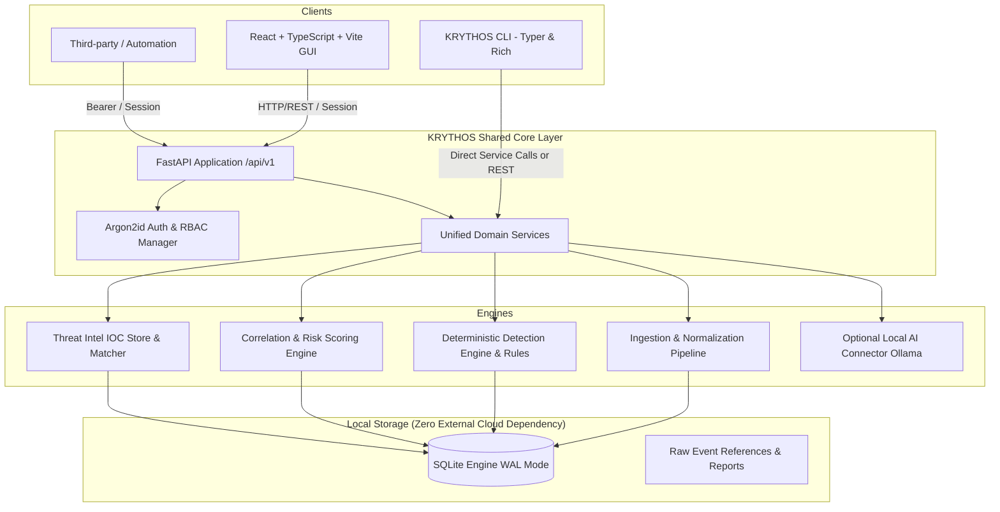

# KRYTHOS Security Operations Platform (KRYTHOS SOC)
## System Architecture & Technical Specifications

> **Tagline:** Every Signal Connected. Every Threat Investigated.  
> **Repository:** `krythos-soc`  
> **Default Local URL:** `http://127.0.0.1:8000`

---

## 1. Architectural Overview

KRYTHOS SOC is a local-first Security Operations Center and SIEM platform engineered for zero-cost, high-reliability deployment on resource-constrained environments (such as Kali Linux VMs with 2GB RAM or workstation hosts).

The platform bridges event collection, normalization, deterministic detection logic, explainable risk scoring, MITRE ATT&CK alignment, case management, and optional local AI assistance into a single unified architecture.

---

## 2. Core Subsystems

### 2.1 Unified Shared Domain Architecture
Both the graphical web interface and the CLI executable (`krythos`) invoke the exact same Python business service layer (`backend/app/services/`). This ensures:
- Detection rules execute identically in batch CLI triage and live API ingestion.
- Risk scoring algorithms and normalization logic are never duplicated.
- Local operations can run entirely offline through the CLI without requiring the web server daemon.

### 2.2 Ingestion & Normalization Pipeline
Supported ingestion formats:
- **JSON & JSONL**: Structured application and security event logs.
- **CSV**: Spreadsheet exports, network logs, tabular telemetry.
- **Linux Auth & Syslog**: `/var/log/auth.log`, `/var/log/secure`, journald-exported logs.
- **Synthetic Demonstration Datasets**: Pre-built security scenarios for training and regression testing.
- **Suricata EVE JSON**: Network IDS alerts and flow telemetry.

Normalized Event Schema:
- `event_id`: UUIDv4
- `timestamp`: UTC ISO8601
- `source_type` & `source_id`: Origin identifier (e.g., `linux_auth`, `suricata`, `synthetic`)
- `host`: Hostname or asset identifier
- `username`: Target or acting principal
- `source_ip` / `destination_ip`: Network endpoints
- `event_category`: `authentication`, `privilege_escalation`, `network`, `process`, `system`
- `action`: `login`, `sudo`, `connect`, `modify_service`, etc.
- `outcome`: `success`, `failure`, `unknown`
- `severity`: `low`, `medium`, `high`, `critical`
- `raw_data`: Full original payload preserved safely

### 2.3 Deterministic Detection Engine
Detection rules are declarative YAML or Python rule definitions featuring:
- **Single-event matchers**: Exact condition matching on fields (e.g., suspicious command lines, unauthorized sudo).
- **Threshold & Window rules**: $N$ events within $W$ seconds matching grouping keys (e.g., $>5$ failed logins for the same user in 60s).
- **Sequence correlation**: Ordered state progressions (e.g., repeated authentication failures followed immediately by a successful login).
- **Suppression windows**: Deduplication to prevent alert storms and log fatigue.
- **MITRE ATT&CK Mappings**: Direct technique IDs (e.g., T1110 Brute Force, T1078 Valid Accounts, T1548 Abuse Elevation).

### 2.4 Incident Response & Investigation Workbench
Provides full investigation lifecycle management:
- Status workflow: `new` $\rightarrow$ `investigating` $\rightarrow$ `contained` $\rightarrow$ `resolved` $\rightarrow$ `closed`.
- Evidence binding: Direct references linking raw events, alerts, and indicators to case records.
- Investigation timeline & notes: Analyst commentary and chronological events.
- Audit logging: Irreversible tracking of status changes and administrative actions.
- Executive & technical report generation: JSON, CSV, and formatted HTML exports.

### 2.5 Local Threat Intelligence & Entities
- Local IOC database supporting IP addresses, domain names, URLs, and file hashes (MD5, SHA256).
- Provenance, confidence scoring, and expiration timestamps.
- Zero mandatory external network calls: indicators are matched locally during event ingestion.

### 2.6 Optional Local AI Assistant
- Pluggable connector supporting local runtimes (e.g., Ollama running `llama3` or `mistral`).
- Deterministic fallback if offline or no model is available.
- Strict safety guardrails: AI responses are labeled as AI-assisted, must cite supporting event IDs, and never execute commands automatically.

---

## 3. Storage & Performance Optimization
- **Database:** SQLite with WAL (Write-Ahead Logging) enabled and `PRAGMA synchronous = NORMAL` for high write throughput.
- **Indexes:** Multi-column indexes on `(timestamp, event_category)`, `(username)`, `(source_ip)`, and `(severity)`.
- **Low-Memory Mode:** Stream processing with generators instead of in-memory buffering for large log imports.
